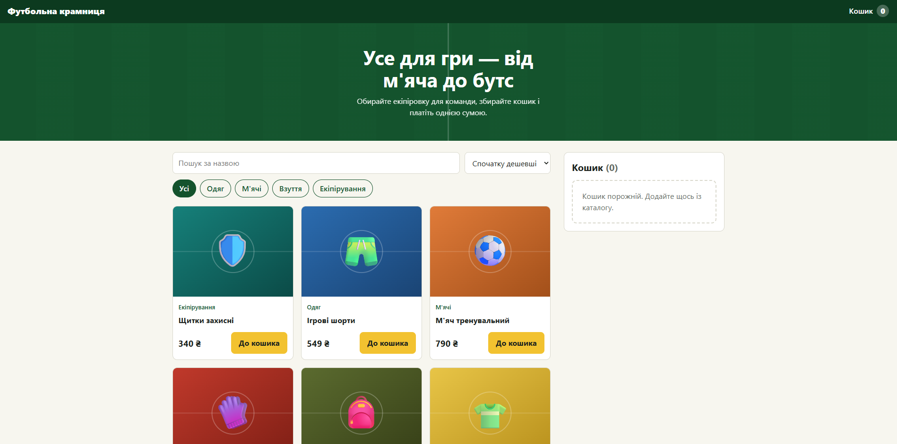

# Футбольна крамниця

Комп'ютерний практикум № 2 з веб-технологій: сайт-каталог із кошиком на Vue.js 3 (Vite).

**Тема:** інтернет-магазин футбольної екіпіровки (продовження сайту «Мій футбол» з КП № 1).

**Демо:** _вставте посилання на GitHub Pages / Netlify_



## Можливості
- каталог із 10 товарів, дані завантажуються через `fetch` з `public/products.json`;
- фільтр за категорією і пошук за назвою (`computed`);
- сортування за ціною;
- кошик: додати, `+` / `−`, видалити, очистити; лічильник у шапці і сума оновлюються одразу;
- промокоди `GOAL10` (−10%) і `TEAM20` (−20%);
- кошик зберігається в `localStorage` (`watch`);
- окремі повідомлення для порожнього кошика й для «нічого не знайдено»;
- адаптивна верстка (на телефоні без горизонтальної прокрутки).

## Компоненти
- `ProductCard.vue` — props `product`, `inCart`; подія `add`;
- `CartItem.vue` — prop `item`; події `change-qty`, `remove`.

## Як запустити
```bash
npm install
npm run dev
```
Збірка: `npm run build` (результат у `dist/`).
